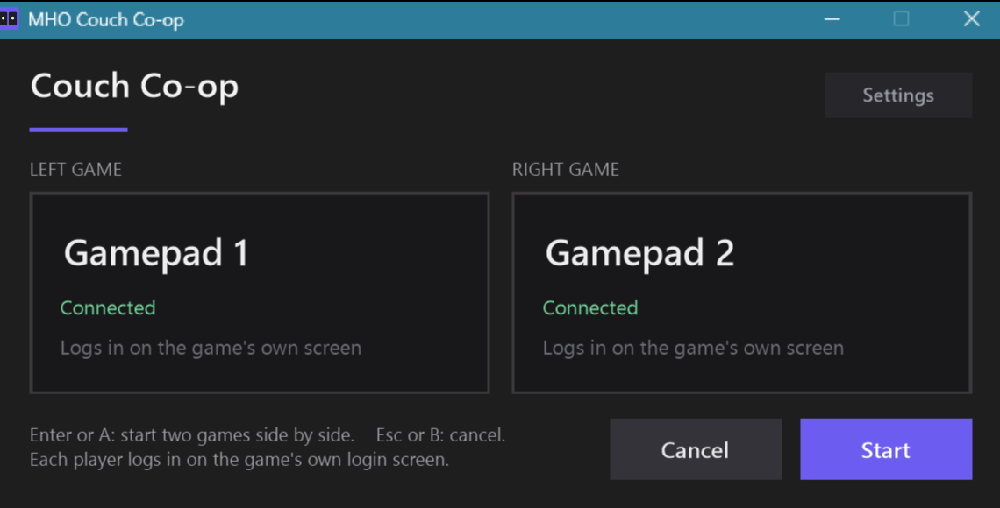

# MHO Couch Co-op

Two Marvel Heroes Omega games side by side on one screen, with one gamepad locked to each.

One small Windows program does the whole job: it starts both games, puts each on its own half of the screen, and ties a gamepad to each window so both players can play at once no matter which window has focus. Mouse and keyboard follow whichever window you click.



## Download

Get the zip from the [Releases](https://github.com/leeper48/MHO-Coop/releases) page and unzip it anywhere. It holds `MhoCoop.exe` and a short readme.

## What you need

- Windows 10 or 11, 64-bit. The app itself needs nothing installed.
- Marvel Heroes Omega and a server to play on, with an account for each player.
- Two XInput gamepads (Xbox pads, or anything Windows sees as one).
- [ProtoInput](https://github.com/ilyaki/ProtoInput/releases) 1.1.2 or newer, unzipped anywhere. It does the gamepad locking; this app drives it for you.

## First run

1. Start `MhoCoop.exe`.
2. Open **Settings** (top right) and set:
   - **Game program**: `MarvelHeroesOmega.exe`, in the game's `UnrealEngine3\Binaries\Win64` folder. A Steam install in the usual place is found automatically.
   - **ProtoInput folder**: press Browse and select `ProtoInputHost.exe` where you unzipped ProtoInput.
   - **Server address**: your server's SiteConfig address.
3. Press **Start** (or Enter, or A on a gamepad).
4. Two games open side by side. Each player logs in on the game's own login screen: click a game to type into it.

## Playing

- RB on either pad brings both games to the front.
- D-pad up or down puts the mouse cursor over that pad's game.
- Mouse and keyboard go to whichever game you clicked last.
- The app sits as an icon near the clock and closes by itself when both games are closed.

Any screen size works. Each game gets half of the main display above the taskbar: about 960 pixels wide per player on a 1080p screen, 1920 on a 4K one.

## No account information is stored

This app presently doesn't store any account information. Logging in happens only inside the game. Anything you type in the Left or Right game options boxes is saved as plain text in the settings file, so don't put a password there unless you are fine with that.

What the app does keep is in `%AppData%\MhoCoop`: the game location, the ProtoInput folder, the server address, the options for each game, the gamepad numbers, and a log of the last session. To keep these next to the program instead, put an empty file named `MhoCoop.ini` beside `MhoCoop.exe` before the first run.

## Updates

The app can update itself from this repository's releases, the same way MHO Extended Mod Manager does.

- **It asks first.** On first start it asks whether to look for new versions. If you say yes, it asks GitHub (`api.github.com`) at start, at most once an hour. Nothing about you, your games or your files is sent. Settings has the same switch, and a **Check Now** button that works either way.
- **It stays out of the way.** A new version shows as a green **Update Available** button in the menu. Clicking it shows the release notes with **Update and Restart**, **Later**, **Skip This Version** and **Release Page**.
- **Updates are signed.** The app installs an update only when the download's signature matches the developer's key built into the app (the same key that signs MHO Extended Mod Manager), and only from GitHub links. A release without a signature is never offered.
- **Nothing is half-installed.** Each file is swapped with the old one kept as `<name>.old`; if any step fails, the old version is put back. The `.old` files are removed at the next start. Your settings are never touched.

## If something goes wrong

- **Linking the gamepads fails:** check that antivirus is not blocking ProtoInput, and that the game and this app are run the same way (both normally, or both as administrator).
- **Windows warns about an unknown publisher:** the program is not code-signed. Build it yourself from this source if you prefer.
- **A pad controls the wrong game:** swap the two gamepad numbers in Settings.

## Building

There is no SDK to install. `build.ps1` uses the C# compiler that ships with Windows (.NET Framework 4.x), which is why the code stays within C# 5.

```powershell
powershell -ExecutionPolicy Bypass -File build.ps1
```

The result is `dist\MhoCoop.exe`.

To try the app without the real game, see [`test/README.md`](test/README.md).

To cut a release the updater will accept:

1. Set the version in `src/Program.cs` and build.
2. On the PC that holds the release key: `tools\make-release.ps1 -Version 1.2.0 -KeyPem <release key .pem>`. It writes `MHO-Coop-1.2.0.zip`, its `.sha256` and its `.sig` into `dist`, and checks the signature against the key built into the app. The private key is never part of this repository.
3. Publish those three files on a GitHub release tagged `v1.2.0`. Drafts and pre-releases are ignored by the updater.

| File | What is in it |
| --- | --- |
| `src/Program.cs` | Entry point |
| `src/PickerForm.cs` | The start menu |
| `src/Dialogs.cs` | Settings |
| `src/Session.cs` | Starting, tiling, attaching ProtoInput, and the gamepad watcher |
| `src/LaunchForm.cs` | Progress window and the icon near the clock |
| `src/Config.cs` | Settings file |
| `src/Updater.cs` | Update check, download, verification, swap with rollback, restart |
| `src/ReleaseSigning.cs` | The developer's public key and the signature check |
| `src/UpdateForm.cs` | The "new version is available" window |
| `src/Native.cs` | Windows, XInput and ProtoInput calls |
| `src/Theme.cs` | Colours and control styling |

## Credits

Gamepad locking is done by [ProtoInput](https://github.com/ilyaki/ProtoInput) by Ilyaki, which is not included here and has its own licence.

Released under the [MIT licence](LICENSE).

This is an unofficial fan project. It is not affiliated with or endorsed by Marvel, Disney or Gazillion Entertainment. Marvel Heroes Omega and all related names are trademarks of their owners.
